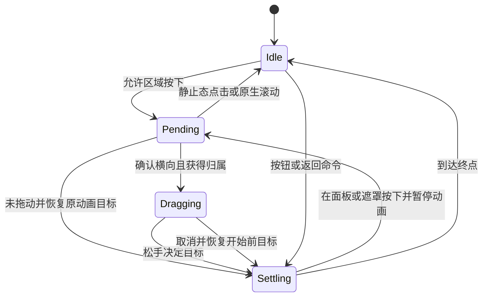

# 移动端侧栏手势优化方案

日期：2026-11-07。状态：两态侧栏与统一手势入口已实现，本地自动化检查通过；浏览器运行与真机性能验收尚未完成。实际交付与验证记录见文末。

目标是让侧栏拖动贴合手指、松手结果可预测、连续操作不中断，同时保留聊天滚动、文本操作、Claudia 导航和 Android 返回行为。

推荐交互为“划动开关侧栏，按钮切换宽度”：保留常规和加宽两种阅读宽度，移除同一次划动中从平移切换为拉宽的行为。技术上使用一个移动端导航手势协调器，结合 `@use-gesture/react` 的输入识别与 Motion 的连续位置及物理弹簧。现有 Sidebar 内容和外观继续复用。

本次实施已按授权采用上述两态开关与独立宽度按钮。文末保留三档兼容分支作为设计参考；当前代码没有实现该分支。

## 当前问题与设计对应关系

| 当前实现 | 影响 | 设计处理 |
| --- | --- | --- |
| `useMobileDrawer.ts` 读取动画位置时，宽度大于 300px 就忽略 transform | 加宽状态关闭过程中重新接手可能跳位 | 一个连续位置值同时驱动拖动与收尾，不再从两个 CSS 动画反推位置 |
| 左栏外层 `useHorizontalDrag` 与 main 内层 `useSwipeBack` 各自跟踪 | 先右划再反向越过起点，可能触发另一套导航 | 一个手势入口，确认归属后锁定至结束 |
| 露出超过 300px 后，每次移动更新 width | 会话列表参与持续布局，存在掉帧风险 | 每次开关手势内固定宽度，只更新 transform 和 opacity |
| 24px 提交距离、多级速度和邻档规则叠加 | 很短慢拖就跳档，边界附近结果突变 | 两态统一距离、速度和回退区间 |
| `sidebarOpen` 同时承担目标状态、可交互状态和视觉存在 | 收起动画未结束就可能放开背景交互 | 分离目标、运动阶段和模态生命周期 |
| hooks 测试 setup 覆盖 Element 和 window 事件监听 | 点击抑制、嵌套滚动测试失真 | 使用真实 jsdom DOM 的独立 setup |

现有实现直接更新 DOM、面板保持挂载，以及保留垂直原生滚动的思路可以继续使用。持续改宽的性能影响需要在实际设备和真实会话数量下测量。

## 用户交互规则

| 场景 | 优化后的行为 |
| --- | --- |
| 侧栏关闭，内容区向右划 | 在允许区域内开始打开；继续保留大范围划动，不默认缩成窄边缘热区 |
| 侧栏打开，在面板或遮罩上向左划 | 跟手收起，包括加宽模式；一次有效划动关闭 |
| 侧栏打开继续右划 | 保持打开，不改变宽度，不触发 Claudia |
| 点击菜单按钮 | 打开常规宽度侧栏 |
| 点击新增的加宽或还原按钮 | 在常规与加宽宽度间切换 |
| 点击遮罩、关闭按钮，或选择导航目的地 | 关闭侧栏；拖动结束产生的兼容 click 不算点击遮罩 |
| 关闭动画尚未结束又右划 | 从屏幕当前实际位置接手 |
| 动画中按住但未形成横向拖动 | 仅在触点位于可见面板或其遮罩时暂时停止；若是点击或垂直滚动，继续原目标动画 |
| Android 返回，加宽侧栏打开 | 先还原常规宽度，再次返回关闭，保留当前返回的层级语义 |
| Escape | 直接关闭；子弹窗打开时先处理最上层弹窗 |

常规宽度为 `min(300px, 可用视口宽度)`，加宽为 `min(420px, 可用视口宽度)`。可用宽度以布局容器及左右安全区计算，不能让最小宽度反过来超过屏幕。两种宽度差小于 24px 时不显示加宽按钮。

加宽按钮位于移动侧栏顶栏，点击区域至少 44×44px，具备明确的展开或还原标签。宽度切换只在静止打开态执行，布局尺寸一次更新；第一版不增加 width 动画。关闭加宽侧栏时保持其宽度直至完全移出，再恢复常规模式，因此重新打开默认是常规宽度。

Claudia 从内容区中间 25%–75% 区域左划打开、在自身面板右划关闭的入口继续保留。项目本轮仅让它参与手势仲裁，不同时重做 Claudia 的动画曲线或业务内容。

## 手势归属与滚动处理

协调器在移动端 shell 的一个 DOM 入口接收输入。每次触摸会话持有唯一 id、输入标识、起点、起始目标、候选滚动容器，以及 `pending / drawer / claudia / native / ignored` 归属。

归属决策按以下顺序执行：

1. 检查最上层界面。权限框、菜单、设置弹窗、通知面板、全屏文件查看器等占用输入时，不启动底层导航；取消正在进行的导航拖动。
2. 检查目标。输入框、可编辑文本、滑块、终端、编辑器、图片缩放区域，以及显式 `data-horizontal-drag-ignore` 区域交给内容自身处理。侧栏打开时也执行排除规则。
3. 少量移动保持 pending。水平位移达到 8px 且 `abs(dx) > 1.25 * abs(dy)` 时才确认横向；垂直方向明显时交给原生滚动。对角线仍不明确时继续观察，位移达到 16px 仍未满足水平优势则交给原生行为。
4. 确认横向时检查嵌套横向滚动容器。若该方向可以继续滚动，整次触摸归内容所有；途中到边缘也不转交给侧栏，下一次触摸才重新判断。终端和编辑器不按滚动边界接管。
5. 侧栏已打开、正在显示或正在关闭时，侧栏优先。否则根据初始方向和起点区域选择左栏或 Claudia。
6. 归属一旦确定，本次手势不能转给另一面板。反向拖动只改变原面板的位置与释放目标。

正常按钮和会话行可以作为拖动起点，但只有确认拖动才抑制其随后产生的兼容 click。必须保留没有拖动的点击、键盘激活，以及下一次新的触摸点击；不用全局 400ms 内禁止所有点击的方式处理。

输入适配以 `@use-gesture/react` 的 `useDrag` 为入口，移动触摸采用 `pointer.touch: true`，绑定到稳定 target，允许非 passive 的 touchmove；仅在确认导航归属且事件可取消时阻止默认行为。库提供轴判断、阈值和点击过滤等能力，但不会自动替项目完成滚动和两个面板之间的仲裁。[手势配置文档](https://use-gesture.netlify.app/docs/options/)

不要为同一会话重复注册 Pointer 与 Touch 两套识别器，也不要同时启用 Motion 的 `drag`。shell 不注册方向键拖动，桌面鼠标行为继续走原有布局。未确认归属时不调用 preventDefault；如果浏览器已经接管、事件不可取消或收到 cancel，则停止导航识别。

手势 CSS 与输入策略需要一起验证：内容区域保留原生滚动和缩放，面板或专用拖动区域可使用 `pan-y pinch-zoom`；不得给整个 body 设置 `touch-action: none`。嵌套滚动容器应保留对应轴的原生处理，不能假设子元素的 `auto` 可以覆盖所有祖先限制。[Pointer Events 规范](https://www.w3.org/TR/pointerevents3/#the-touch-action-css-property)

## 连续位置与状态机

两态开关使用露出距离 `p`，范围 `0..W`，`W` 为本次手势固定的面板宽度：

```text
panelX = p - W
backdropOpacity = 0.5 * clamp(p / W, 0, 1)
```

拖动时直接把手指位移映射到 p。第一版不增加弹性超拉，不给跟手阶段套弹簧或低通滤波，避免面板追赶手指。激活前的 8px 不产生视觉位移，确认时只显示超过激活距离的部分。

连续位置由 MotionValue 保存，React 只保存需要渲染的离散状态。MotionValue 可以在不触发 React 重渲染的情况下更新样式，并提供停止动画和读取当前值的能力。[MotionValue 文档](https://motion.dev/docs/react-motion-value)

```ts
type DrawerPhase = 'idle' | 'pending' | 'dragging' | 'settling';
type DrawerWidthMode = 'compact' | 'wide';

// 以下为职责示意，并非已实现接口。
interface DrawerState {
  phase: DrawerPhase;
  targetOpen: boolean;       // 当前要抵达的状态
  settledOpen: boolean;      // 最近完成的稳定状态
  widthMode: DrawerWidthMode;
  modalActive: boolean;      // 控制背景交互和焦点生命周期
}
```

动画句柄、p、手势归属、开始位置、释放采样和操作版本号存放在 ref 或 MotionValue 中，不把 touchmove 写入 Zustand 或 App 的 React state。



重新接手时执行 `stop → 读取 p → 记录手指起点 → 继续更新 p`。以 MotionValue 为位置来源，不再读 CSS width 和 matrix 来拼接位置。尚未获得归属的内容区触摸不暂停其他面板的动画。

每次按钮命令、拖动、取消或动画重定向递增操作版本号。动画完成回调只允许提交同一版本的状态，防止旧的关闭回调把刚打开的面板隐藏。按钮、遮罩、Escape、Android 返回和导航跳转统一调用控制器命令，不能再让 effect 和事件处理器各自启动一套收尾动画。

外部命令到达时取消当前拖动归属，再执行新命令；残留 touchend 不得反向提交。横竖屏切换或布局断点改变时，取消手势并重新测量：移动端内按已有目标重建位置，切到桌面时清理动画、背景锁定、内联样式和临时状态。页面隐藏或卸载时同步清理，不依赖 transitionend 才释放背景。

## 松手决策和动画参数

以下数值是第一版调试起点，不是已经验证的最终手感参数。配置集中在一个文件，测试与运行时使用同一单位。

| 参数 | 初值 | 用途 |
| --- | --- | --- |
| 横向激活距离 | 8px | 过滤点击抖动 |
| 水平优势比例 | 1.25 | 让斜向滚动优先保持原生 |
| 模糊方向最大观察距离 | 16px | 避免长时间等待归属 |
| 快甩速度 | 550px/s | 允许短而明确的划动完成开关 |
| 快甩最小有效位移 | 16px，扣除激活距离后 | 避免两三个采样点抖动触发 |
| 释放速度窗口 | 最后 80ms | 反映最近意图；只取末尾同方向运动段 |
| 静止判定 | 最后移动距松手达到 80ms | 将释放速度归零 |
| 非快甩预测时间 | 0.16s | 为缓慢运动提供有限动量 |
| 非快甩最大预测位移 | 0.2W | 防止速度采样放大结果 |
| 开启阈值 | 0.55W | 原目标为关闭时越过该点才开启 |
| 关闭阈值 | 0.45W | 原目标为打开时低于该点才关闭 |
| 弹簧初值 | stiffness 500，damping 45，mass 1 | 接近临界阻尼，避免明显振荡 |
| 弹簧停止条件 | restDelta 0.5px，restSpeed 10px/s | 收尾后精确写入终点 |

普通释放按以下确定顺序选择目标：

```text
priorTarget = 手势开始前的动画目标；静止时等于稳定开关状态

若末尾同方向有效位移 >= 16px，且 abs(v) >= 550px/s：
    v > 0 打开，v < 0 关闭
否则：
    projected = clamp(p + clamp(v * 0.16s, -0.2W, 0.2W), 0, W)
    projected >= 0.55W → 打开
    projected <= 0.45W → 关闭
    其余 → 保留 priorTarget
```

速度采样采用事件时间戳；持续时间过短时设置最小测量跨度，并对异常值做有界处理。方向从末尾运动段判断，不能只用整次拖动的平均速度。停顿后松手速度应为零；轻微反向抖动不直接改变目标，明确反向快甩则可反转结果。释放点 clamp 后如果速度仍朝越界方向，传入动画前将该方向速度清零。

业务算法统一使用 px/s。use-gesture 的 velocity 为 px/ms，适配层必须乘以 1000，并与方向组合成带符号速度，避免库之间出现千倍误差。[手势状态文档](https://use-gesture.netlify.app/docs/state/)

选择目标后使用物理弹簧携带释放速度收尾。不要使用 duration 加 bounce 的弹簧替代，因为那类动画不衔接已有速度。[Motion 过渡文档](https://motion.dev/docs/react-transitions)

普通 300px 行程以约 220–350ms 达到视觉稳定为调优目标，完成时间以实际 rest 条件为准。位置和遮罩都限制在合法范围，抵达边界后终止继续向外的运动。减少动态效果开启时保留必要的直接跟手反馈，松手立即到目标或使用不超过 100ms 的短过渡。

## 模态语义与平台集成

打开拖动阶段展示真实面板内容，但不在每次移动时改焦点。确认打开目标时激活焦点约束和背景隔离；关闭时保留这些约束直到面板完全移出。取消打开则不把焦点转移到侧栏。当前触摸目标在内容区时，不在触摸过程中把其祖先设置为 inert，防止中断输入链；该手势的滚动与兼容点击由协调器控制。

`modalActive` 不直接等于 `targetOpen`。关闭动画期间 backdrop 仍负责阻止点击穿透。关闭完成后才设置面板 inert、禁用命中、释放背景滚动并恢复焦点；导航导致原触发元素卸载时，将焦点交给目标页面的合理入口。

焦点陷阱应处理初始焦点在 dialog 容器、没有可聚焦子项、动态禁用和隐藏子项等情况。上层 portaled modal 出现时暂停侧栏焦点陷阱；不得把 modal 所在的 document.body 一并 inert。保持项目列表的滚动位置，打开与关闭不重新挂载整个 Sidebar。

Android 继续复用现有 `useAndroidBack` 优先级系统。协调器以显式的 overlay 状态屏蔽底层导航，不能通过 DOM 上是否存在任意 `role=dialog` 猜测——关闭的侧栏本来就保持挂载。现有主界面返回打开菜单、shell mode 返回主界面的语义保持不变；侧栏动画期间也必须占有正确的返回处理。

平台验收分为 Android Tauri、Android Chrome、iOS Safari 和 iOS PWA。浏览器或系统的最外沿返回手势拥有优先权：不承诺用网页 preventDefault 抢占系统导航。在 iOS 浏览器上保留菜单按钮和内侧内容区右划；最外沿触摸排除宽度作为平台配置，经真机测量确定。MUI 默认禁用 iOS 的 swipe-to-open，说明这项冲突需要专门处理，但不意味着本项目必须关闭整个内容区手势。[MUI API](https://mui.com/material-ui/api/swipeable-drawer/)

多指进入时取消本次导航并恢复开始前目标，把缩放交回内容。touchcancel、页面失焦、顶层模式切换和组件卸载都必须释放归属；不能出现下一次触摸仍被旧手势占用的情况。

## 代码职责和改动范围

以下路径均相对于 `apps/desktop/src`。新模块控制在当前需求范围内，不构建通用的全应用手势框架。

| 文件 | 职责或改动 |
| --- | --- |
| `app/useMobileNavigationGesture.ts`，新增 | 一个输入入口；管理目标排除、滚动归属、左栏与 Claudia 仲裁及取消 |
| `app/useMobileDrawer.ts` | 侧栏控制器；MotionValue、动画句柄、离散状态、命令和布局变化处理 |
| `features/sidebar/drawerMotion.ts`，新增 | 几何、释放决策、单位转换、集中参数等可独立验证的纯逻辑 |
| `features/sidebar/drawerStage.ts` | 迁移期间保留旧实现；两态方案完成后删除三档手势规则，宽度模式与开关状态分离 |
| `features/sidebar/Sidebar.tsx` | 面板与遮罩绑定连续值；按生命周期管理交互，不在子树传递逐帧 React props |
| `features/sidebar/MobileSidebarHeader.tsx`、`types.ts` | 增加加宽与还原按钮、相应语义和回调 |
| `features/sidebar/useMobileDrawerFocus.ts` | 焦点进入、恢复、陷阱和上层弹窗暂停逻辑 |
| `app/MobileOverlays.tsx` | Claudia 接收协调器输出；移除重复的原生识别入口 |
| `App.tsx` | 只连接开关命令、页面状态和 overlay 状态，移除两套竞争的 shell recognizer |
| `hooks/useHorizontalDrag.ts`、`hooks/useSwipeBack.ts` | shell 迁移完成后检查引用；当前业务调用均来自 shell，无剩余消费者时删除 |
| `styles/index.css` | 去掉侧栏 transform/width 的 CSS transition 双重控制；保留静态结构、安全区、阴影和按需合成提示 |
| `test/setup-gestures.ts`，新增 | 使用真实 jsdom DOM，仅补充确实缺失的浏览器 API |
| Vitest 配置与 `scripts/test-sequential.mjs` | 把新增测试纳入正确 suite，保证直接运行和项目 test 入口都能发现 |
| `apps/desktop/package.json` 与根 lockfile | 引入并锁定验证过的 use-gesture 和 Motion 版本，检查 React 19 与构建兼容性 |

依赖安装前检查发布版本和 peer dependencies。构建前后比较实际产物增量，记录 gzip 和初始 chunk 变化；若增量不可接受，优先减少导入范围或只保留 Motion 的动画能力，不额外叠加第三套抽屉实现。

Base UI Drawer 可用于独立验证标准两态抽屉，但本方案优先保留项目现有的内容区开启策略和跨面板仲裁。Base UI 的 SwipeArea 与侧向关闭已具备组件支持，其 snap points 文档主要描述底部抽屉，不把它当作横向变宽三档的直接替代。[Base UI Drawer](https://base-ui.com/react/components/drawer)

## 实施顺序

| 阶段 | 交付内容 | 进入下一阶段的条件 |
| --- | --- | --- |
| 1 建立基线 | 修正手势测试 setup；录制现有慢拖、快甩、反向和中途接手；固定测试设备、视口和数据量 | 可以稳定重现当前位置跳变及跨导航归属问题；测试失败能区分代码和 mock |
| 2 单一位置控制 | 接入 MotionValue 与可中断弹簧；分离目标和可交互生命周期；接入统一命令 | 接手无位置突变；关闭期间不穿透；旧动画回调不会覆盖新命令 |
| 3 统一手势入口 | 引入 use-gesture，串接左栏与 Claudia 仲裁；覆盖滚动、排除目标和取消 | 一次触摸至多一个导航动作，原生滚动与输入保留 |
| 4 简化交互 | 两态释放规则、加宽按钮、Android 返回和自适应宽度 | 慢拖、短快甩、停顿、反向行为符合表格；宽度不会在拖动中变化 |
| 5 真机调优与收尾 | 在各平台录制和测量；调整集中参数；清除旧入口和重复动画代码 | 完成下面的行为和性能验收，产物增量可接受 |

过渡期间用一个内部配置在创建控制器前选择旧或新实现；同一页面绝不同时挂载两套事件处理器。该配置不进入用户设置。旧实现只保留到验收与回退窗口结束，避免长期维护两套手势。每个阶段作为独立可回退提交，不与现有聊天性能改动混合。

## 测试和验收

纯逻辑测试覆盖释放阈值两侧、回退区间、快甩最小位移、速度单位、静止释放、反向末段、越界、窄屏、宽度模式以及操作版本号。不要只断言实现内部常量，应使用输入轨迹和预期的用户行为描述用例。

Hook 和组件测试使用真实 DOM 事件传播，覆盖嵌套滚动、按钮兼容点击、下一次正常点击、控件排除、cancel、多指、unmount、旧动画回调及模态焦点。现有 hooks setup 会覆盖 `Element` 与 window 监听，因此不能用那个环境的失败直接判断真实滚动和点击行为。

浏览器集成测试通过触摸事件序列驱动实际 UI，并采样可见位置；jsdom 不能验证 CSS 动画中间帧。Chromium 自动化和 WebKit 自动化用于回归，iOS Safari/PWA 的系统返回、软键盘和原生滚动仍需真机验证。

| 验收场景 | 必须满足的结果 |
| --- | --- |
| 慢拖约 10% 宽度，停住再松手 | 回到原目标，不因旧 24px 规则跳开或跳关 |
| 慢拖到打开阈值之外，停住再松手 | 完成打开；关闭方向对称 |
| 超过最小位移的短快甩 | 按末尾明确方向完成 |
| 先右划后左划，越过原起点 | 只操作已经获得归属的侧栏，不打开 Claudia |
| 在动画 25%、50%、75% 进度重新拖动 | 接手第一帧位置差不超过 2px，不计手指本次实际位移 |
| 在动画中点击、纵向滚动但未横拖 | 不永久停在半开位置；没有误提交导航 |
| 连续开关、中途点按钮或按返回 | 最后一个有效命令获胜，没有旧动画隐藏新界面 |
| 代码块向可滚动方向滑动，随后到边缘 | 整次滑动保留给代码块；下次手势才可打开导航 |
| 纵向滚动聊天和侧栏长列表 | 无水平面板闪动；滚动位置保留 |
| 输入框选字、终端、滑块、图片缩放 | 不触发底层导航 |
| 拖动从会话行或遮罩开始，抬手 | 不产生误选会话或额外关闭；下一次点击正常 |
| 关闭动画期间点击背景 | 背景不响应 |
| 上层 modal、软键盘、旋转、切换桌面断点 | 归属和焦点可恢复，界面没有残留遮罩或滚动锁 |
| reduced motion、Tab、Shift+Tab、Escape、屏幕阅读器 | 有可操作按钮入口，焦点约束与恢复符合模态生命周期 |

性能验收使用两组固定数据：轻量列表，以及至少 50 个项目、500 个会话的重列表；分别在聊天静止和流式输出时测量。记录设备、系统、WebView/浏览器版本、刷新率和构建类型，旧新实现用同一场景对比。

初始性能目标：60Hz 设备上稳态连续拖动的帧间隔 p95 不超过 20ms；手势处理函数耗时 p95 不超过 2ms；没有由侧栏开关拖动引起的逐帧 width 布局和超过 50ms 的长任务。120Hz 设备另外按 8.3ms 帧预算观察，不把 60Hz 达标当作高刷新率达标。聊天本身的长任务单独归因，不能算作侧栏方案已经解决。

React Profiler 中，连续 move 不应驱动 App 和完整 Sidebar 子树逐帧重渲染；开始、归属确认、目标提交和动画完成允许离散更新。开发态日志只记录手势类型、时间和结果，不记录消息、输入内容或 DOM 文本。测试入口需包含新增纯逻辑、hooks、UI 和移动浏览器集成用例；实现完成后运行对应测试、类型检查、lint 以及构建。

## 保留三档划动时的兼容方案

若产品选择继续通过左右划动切换 `closed / peek / full`，仍采用同一协调器与单一位置值，但保留宽度变化的代价需要明确。

三个位置为 `0 / 300 / expandedWidth`。每一帧从同一个位置 p 推导 `width = max(300, p)` 与 `x = min(0, p - 300)`，收尾也动画 p 本身，不能再让 width 和 transform 独立补间。窄屏则先把两个展开位置约束在可用宽度内并合并重复档位。这样能修复接手反推错误，但跨越 300px 后仍会产生布局，不能宣称全程仅合成。

慢拖采用位置预测与相邻档位之间的比例边界，并在起始档位附近设置回退区；明确快甩最多从起始逻辑档位推进一档。若手指已经实际拖过更多档位，按实际位置选择，不因松手恰好落在 300px 就额外跳档。去掉“所有短慢拖满 24px 都跳档”和“某个左甩速度突然跨两档”的特例。中途接手时以捕获前的动画目标作为逻辑起始档位，当前 p 作为几何起点。

第一轮可先保持真实内容改宽，并以重列表真机结果决定是否进一步优化。只有需要且验证有收益时再考虑固定宽度内容加裁剪；该方法可能隐藏列表右侧操作，不能把裁剪宽内容当成现有自适应宽度的无损替代。三档分支需要额外验收全部六个有向档位转换、300px 边界附近释放、跨档拖回、极窄视口和改宽布局耗时。

## 实施记录与当前验收边界（2026-11-07）

本次实际采用两态开关与独立宽度按钮。上面的参数、平台矩阵和性能预算仍是验收目标，不代表已经获得真机测量结果；三档兼容分支没有实施。

已交付的代码：

- `useMobileDrawer.ts` 以 MotionValue 保存露出距离，统一处理中断、物理弹簧、操作版本、开关目标与模态生命周期。拖动和收尾固定宽度；宽模式关闭完成后恢复常规宽度。页面隐藏、断点切换以及 Settings 等页面移除 shell 时清理；shell 延迟挂载或重新挂载时重新测量并绘制。shell 是否存在与临时手势阻断分开处理，打开上层菜单不清空侧栏宽度或模态状态；宽模式关闭中发生 resize 也恢复常规模式。组件生命周期复用 `useIsMounted`，覆盖 StrictMode 重放与卸载。
- `useMobileNavigationGesture.ts` 使用 `@use-gesture/react` 的 `useGesture({ onDrag })`，触摸输入配置为 `pointer.touch: true`，关闭键盘拖动与库级点击过滤。单一入口执行目标排除、轴向确认、嵌套滚动优先、侧栏与 Claudia 归属锁定、兼容 click 的捕获阶段抑制及取消。两个适配器的操作版本均参与失效检查，外部打开侧栏也会取消尚未结束的 Claudia 拖动。
- `drawerMotion.ts` 集中几何、释放阈值、预测、速度单位与弹簧参数；`mobileNavigationGesture.ts` 保存轴向、滚动与末段释放速度的纯逻辑。App 连接菜单、遮罩、导航、Android 返回和宽度按钮；Claudia 继续复用原有预览方式。
- 侧栏保持挂载；焦点和背景隔离沿模态生命周期保留至关闭完成。上层共享 Modal、Select 和 DropdownMenu 通过 `useMobileNavigationBlocker.ts` 显式登记，暂停底层导航与焦点处理；关闭侧栏时不抢走上层弹窗的焦点。Sidebar 自有覆盖层在卸载时注销。
- 已删除无剩余生产引用的 `useHorizontalDrag.ts`、`useSwipeBack.ts`、`drawerStage.ts` 及对应旧测试，不保留同时运行的旧手势入口或内部切换开关。
- 精确锁定 `motion@14.10.1` 与 `@use-gesture/react@10.3.1`。安装前查询的 peer 范围分别支持 React 18/19 与 React >=16.8，本项目使用 React 19.2.7。lockfile 仅新增这两个依赖及其相关包。

测试使用独立的 `setup-gestures.ts` 与真实 jsdom Element、window、document 事件传播，仅补齐缺失的 matchMedia、ResizeObserver。`test:gestures`、`test:all` 与顺序测试入口均包含新增套件，UI 与其他套件排除重复测试；顺序入口同时补齐了 `src/app/**/*.test.tsx` 的发现规则。

与原实施顺序的差异：旧实现已在确认无剩余消费者后删除，没有保留到真机验收结束，也没有提供运行时回退开关。本次以单个实现提交交付，没有分阶段回退提交；需要回退时，应一起恢复本次提交中的源码、测试入口和依赖锁定，不能仅切换配置。浏览器和真机验证仍未完成，代码删除与本地测试通过不代表已完成阶段 5 的性能验收。

已执行的检查（命令从仓库根目录运行，注明例外者除外）：

| 检查 | 结果 |
| --- | --- |
| 迁移前旧拖动与 drawerStage 基线 | 16 + 26 = 42 项通过；迁移后对应旧源码与测试已删除 |
| `pnpm --filter @zclaudia/desktop test:gestures` | 6 个文件、62 项通过，覆盖释放规则、接手、旧完成回调、跨面板取消、滚动归属、点击、焦点和模态登记 |
| `pnpm --filter @zclaudia/desktop test:ui src/app/__tests__/App.topLevelView.test.tsx src/app/__tests__/MobileOverlays.test.tsx src/features/sidebar/__tests__/Sidebar.drawer.test.tsx src/components/__tests__/Sidebar.test.tsx src/components/ui/__tests__/Modal.test.tsx src/components/ui/__tests__/Select.test.tsx src/components/ui/__tests__/DropdownMenu.test.tsx` | 7 个文件、138 项通过；包括 Claudia 原有 60px 预览归一化及打开共享菜单时保持侧栏显示的回归 |
| desktop 目录内 `node scripts/test-sequential.mjs src/app/__tests__/App.topLevelView.test.tsx` | 正确发现并通过 16 项；新手势、焦点与登记测试也已用顺序入口验证发现 |
| `pnpm install --frozen-lockfile --ignore-scripts` | 全部 8 个 workspace 安装完成；恢复 filtered add 后缺失的 shared/plugin-sdk 链接，无额外 manifest 或 lockfile 变更 |
| `pnpm --filter @zclaudia/shared build` | 通过 |
| `pnpm --filter @zclaudia/desktop run build` | shared 编译、TypeScript 与 Vite 生产构建通过；仍有现有的动态导入与 chunk 大小提示 |
| desktop 目录内针对控制器、协调器、焦点、登记和 Select/Dropdown 的 ESLint，以及 `node scripts/check-react-lifecycle-invariants.mjs` | ESLint 0 error；Select/Dropdown 保留 2 条与 HEAD 相同的既有 warning；生命周期检查通过 |
| Playwright mobile-navigation 配置的 `--list` | 发现 4 项浏览器回归；发现测试不等于执行通过 |

当前生产构建主入口为 922.63 kB，gzip 257.39 kB。现有旧产物无法确认来自相同源码基线，因此没有可归因于本次改动的准确 bundle 增量，不能用此数值宣称依赖成本已达标。

浏览器回归位于 `e2e/playwright.mobile-navigation.config.ts` 与 `e2e/tests/mobile-navigation.playwright.spec.ts`，fixture 使用实际控制器和协调器，并检查 CDP 输入的 `isTrusted`。本轮 Chrome 启动在沙箱内发生 EPERM/SIGABRT，按要求提交的 `require_escalated` 重试被工具明确拒绝（`rejected by user`）。因此没有执行浏览器运行时断言，也没有再次尝试启动或绕过拒绝。jsdom 结果不能证明 CSS 中间帧、浏览器原生滚动或系统边缘返回的实际表现。

仍待完成：允许浏览器启动后的 Chromium 回归、WebKit 回归，以及 Android Tauri/Chrome、iOS Safari/PWA 真机检查；软键盘、多指缩放、系统边缘返回、50 项目/500 会话重列表与流式输出场景的录制和测量。本轮没有真实帧间隔、事件耗时、React Profiler 或可归因长任务数据，文中的 p95 和 2px 接手预算仍待实际验证。
